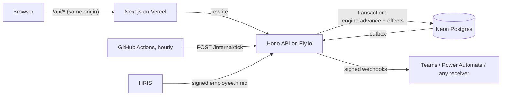

# Arunika Workflows

**Leave, onboarding, PKWT renewal and offboarding as versioned workflow definitions, run
by a small state-machine engine with working-hour SLAs, escalation up the reporting line,
a transactional webhook outbox and process analytics.**

Built for Arunika Life, a fictional Indonesian life insurer with about 230 employees across
Jakarta and four branches. Six months of history were produced by the engine itself and are
labelled as simulated. All people and figures are synthetic.

| | |
|---|---|
| **Live app** | <https://arunika-workflow.vercel.app> |
| **API** | <https://arunika-workflow-api.fly.dev/health> |
| **Demo accounts** | Six seats (employee, line manager, department head, HRBP, IT support, HRIS admin), one click each on the sign-in page; password `arunika-demo` |

The API scales to zero, so the first request after a quiet period takes a few seconds.

---

## Why this exists

Most HR processes are a chain of hand-offs between people who each own one step. They stall
in predictable places: an approval waiting on a manager who is travelling, a laptop for a
branch joiner that has to ship from Jakarta, a PKWT that lapses because nobody decided in
time. This project makes the hand-offs explicit, gives every step a deadline in working
hours, moves overdue work up the line, and measures where time goes.

## What it does

**Four workflows** ([definitions](api/src/definitions/index.ts)):

- **Leave.** Before a request starts, the form computes working days against the 2026
  national holidays and cuti bersama, applies the statutory limits, and checks the balance
  ([rules and sources](docs/leave-policy.md)). Statutory limits covered: Pasal 93 special
  leave, maternity, and paternity under UU KIA.
  - Routing: line manager first. Requests over five days, or unpaid leave, also go to the
    department head, unless the line manager *is* the department head.
- **Onboarding.** Triggered by a signed `employee.hired` event from the HRIS.
  - Day-one setup runs in parallel across IT, General Affairs, HR and Payroll, followed by
    mandatory compliance training (including APU-PPT awareness).
  - For PKWTT hires, the workflow then waits until two weeks before probation ends and opens
    the probation review.
- **PKWT renewal.** Started by a daily scan 45 days before a contract ends.
  - The manager chooses renew, convert or end. Renewal is only offered while the PKWT total
    stays within five years (PP 35/2021 Pasal 8).
  - The compensation for the ending period is computed as months ÷ 12 × monthly wage
    (Pasal 15–16).
- **Offboarding.** Resignation, manager acknowledgement, then parallel clearance:
  - assets;
  - access revoked on the last day;
  - final pay including unused leave and PPh 21;
  - BPJS report;
  - the exit interview.

**The engine** ([engine.ts](api/src/engine/engine.ts)) is a pure state machine:
`start(definition, context)` and `advance(definition, state, event)` return a new state and
a list of effects (create task, escalate, notify, run an action, finish).

- It never touches the database or the clock, which makes it fully unit-testable.
- The live runtime and the history simulator call the same functions.
- Supported step types: approval, decision, task, parallel (join all), condition, wait,
  action, notify, end.
- Definitions are JSON validated by Zod, plus structural checks: unknown references,
  duplicate ids, unreachable steps, and a flow that never ends.

**Deadlines in working hours.** An SLA of 16 hours on a request raised on Friday afternoon
falls due on Tuesday, not Saturday.

- Working hours are 08:00–17:00 WIB.
- Weekends and the 2026 holidays from SKB 3 Menteri are excluded: 17 national holidays and
  8 cuti bersama days, taken from the Setneg publication.
- An overdue task escalates on the scheduler's tick: first to the step's named target,
  then up the line, at most twice.
- Role queues (IT, GA, Payroll, HR operations) escalate to the head of the department that
  owns them.

**Versioning.** Admins publish a new version from the UI, which shows a line diff against
the previous one. Running requests keep the version they started on.

**Integration.**

- Outbound webhooks are written to an outbox in the same transaction as the change, then
  delivered on the next tick with an HMAC-SHA256 signature and exponential backoff.
- A webhook can use the Adaptive Card format. That is the payload a Microsoft Teams
  Workflows or Power Automate "When a HTTP request is received" trigger expects.
  (Compatible by design; not tested against a tenant.)
- Inbound `POST /hooks/hris` accepts a signed `employee.hired` event and starts onboarding.

**Process analytics.** Per workflow and per step:

- median and 90th-percentile duration in working hours;
- on-time rate against the original deadline;
- escalations;
- a split of any step by office.

## What the simulated history shows

The seed drives the real engine forward through six months with a simulated clock. The
simulator only decides **when** each person responds and **what** they decide:

- When: a log-normal delay per kind of assignee, in working hours.
- What: approval and rejection rates per step.

Everything else is computed by the engine and the calendar: deadlines, escalations, joins,
waits for probation reviews, renewals started by the scan. Requests still open at the
moment of seeding stay open, so each demo seat has real work waiting.

One bottleneck was planted deliberately: laptops for branch joiners take longer because
they ship from Jakarta (median response 30 working hours against 10 in Jakarta, with a
24-hour SLA). The analytics page finds it without being told:

| Step: prepare and hand over a laptop | Jakarta | Branches |
|---|---|---|
| Median | 9.0 working h | 25–27 working h by office |
| On time | 100% | 0–50% by office |
| Tasks | 5 | 6 |

These figures come from the deployed dataset, seeded on 6 November 2026. Re-seeding
generates the history around the new date, which moves them slightly.

The samples are small, and the page says so. What the table shows is that the pipeline
from engine to analytics surfaces a real pattern in the data; the specific numbers matter
less. Other figures on the page are properties of the simulation parameters, not findings
about any real company. For example, leave approvals have a median cycle of 4.3 working
hours, and onboarding has a 90th percentile of about 21 working days because of the
two-week training step.

## Architecture



- **One transaction per user action.** It locks the instance, runs the engine, inserts tasks,
  events and notifications, queues webhooks, and saves the new state. A failed action rolls
  everything back, including the outbox, so a step that didn't happen never notifies
  anyone.
- **No in-process timers.** The API scales to zero, so everything time-based happens on the
  tick: escalations, finished waits, the renewal scan, deactivating people after their last
  day, and webhook delivery. The tick is idempotent.
- **Assignee rules** are resolved against the directory by pure functions
  ([assign.ts](api/src/services/assign.ts)). A manager who has left is skipped, a department
  head's own request goes one level up, and an HRBP-less department falls back to the HR
  queue.

## Running it locally

Requires Node 22+ and PostgreSQL 15+ (a free Neon branch works).

```bash
cd api
npm install
cp .env.example .env          # set DATABASE_URL, JWT_SECRET, HOOK_SECRET, INTERNAL_TOKEN
npm run seed                  # schema, directory, definitions, six months of history
npm run dev                   # http://localhost:8002
npm test                      # 61 tests: engine, calendar, leave and PKWT rules, API
```

```bash
cd web
npm install
npm run dev                   # http://localhost:3000, proxies /api to :8002
```

## Design decisions and trade-offs

- **A small engine instead of a BPM product.** Four HR workflows need sequence, parallel
  joins, conditions, waits and decisions. A few hundred lines of tested TypeScript
  covers that and keeps every rule readable. Compensation steps, sub-processes and
  timers inside steps are out of scope.
- **SLAs measure working hours, analytics too.** Calendar hours would make every Friday
  request look slow and every escalation look premature.
- **Escalation reassigns rather than copies.** The task moves to the next person, and the
  original deadline is kept for on-time reporting. A real deployment might notify the
  original assignee as well.
- **The definition language is JSON edited as text.** A visual editor would be friendlier;
  the server's validation is what keeps edits safe either way.
- **Company policy is marked as such:** observing cuti bersama without charging annual
  leave, pro-rating the first eligible year, 30 days' notice. Each is a setting, not a legal
  claim.

## Limitations

- Holidays are loaded for 2026 only; admins add later years on the Admin page. Until then
  only weekends are excluded.
- The directory is a local copy; production would keep it in sync from the HRIS through the
  inbound events.
- Scheduled GitHub Actions can run late, and are disabled after 60 days without repository
  activity. The admin page can run the tick by hand.
- Demo accounts share a password and anyone can sign in. The data is synthetic.

## Project layout

```
api/src/engine/       calendar (working time, 2026 holidays), schema, state machine
api/src/domain/       leave rules, PKWT compensation and the five-year limit
api/src/definitions/  the four workflows
api/src/services/     runtime, assignee resolution, requests, scheduler, analytics
api/src/routes/       HTTP endpoints
api/src/seed/         directory generator, history simulator, loader
api/test/             engine, calendar, domain, assignment and API tests
web/src/app/          inbox, requests, workflows, analytics, admin
docs/                 leave rules and sources
```

## License

MIT. See [LICENSE](LICENSE).
